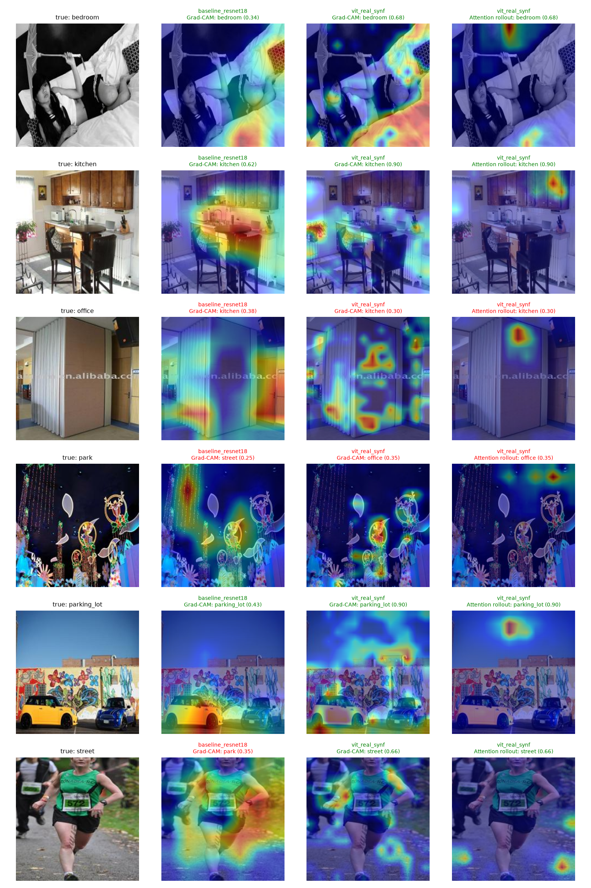
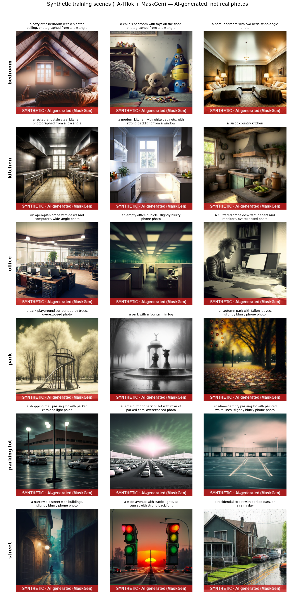

# Scenery Recognition System

Scene classification with a Vision Transformer and **TA-TiTok + MaskGen** synthetic data, plus a Gradio web app that
shows *why* the model made each prediction.

Six scene classes: **bedroom, kitchen, office** (indoor) and **park, parking lot, street** (outdoor).

> Computer Vision — Assignment 2 (Advanced track: scene classification).
> SOTA component: TA-TiTok + MaskGen (ByteDance & POSTECH, 2025) for synthetic gap-filling
> ([paper](https://arxiv.org/abs/2501.07730), [Neurohive summary](https://neurohive.io/en/state-of-the-art/bytedance-unveil-ta-titok-tokenizer-achieving-sota-in-text-to-image-generation-using-only-public-data/)).


*Grad-CAM of the CNN baseline vs Grad-CAM and attention rollout of the ViT on in-the-wild test photos.*

---

## Highlights

- **ViT-S/16 beats the ResNet-18 baseline by about 10 points** on both the Places365 test set and the in-the-wild set.
- **Quality-filtered synthetic data helps on both test sets:** in-the-wild macro-F1 0.925 → 0.962 and Places365 accuracy
  0.907 → 0.918 (means of 3 seeds) over the real-only ViT.
- **Synthetic-data quality filter:** a real-only classifier rejects generated images that don't look like their class
  (40 of 601), exposing ambiguous prompts such as "corporate office with glass walls" (16 of 21 drawn as street).
- **Targeted synthetic data:** MaskGen generates 600 scenes in hard conditions (night, snow, rain, backlight, odd angles),
  and classes the baseline was worst at get more images.
- **Honest evaluation:** test sets contain only real photos, the key runs are repeated over 3 seeds, and results are
  reported as mean ± std.
- **Explainability:** Grad-CAM for both models and attention rollout for the ViT.
- **Web app with five tabs:** classify a photo (upload or camera) with a heatmap of what the model looked at, find the
  most similar real training photos (retrieval, P@5 = 0.89), browse the pre-generated synthetic scenes next to the
  class they are most often confused with, and read the results. It shows latency, device and browser, works on a
  phone and can be installed there as an app.

## Pipeline

```
Places365 (6 classes) ──► ResNet-18 baseline ──► per-class F1 ──► MaskGen prompt budget
        │                                                             │
        │                     TA-TiTok + MaskGen-L (text → image) ◄────┘
        │                                  │  601 synthetic scenes (night, snow, rain, ...)
        │                                  ▼
        │                     quality filter (real-only ViT) ──► 561 kept, 40 rejected
        ▼                                  ▼
   real train set ─────────────► ViT-S/16 fine-tuning ──► evaluation on REAL images only
                                                            ├─ Places365 test (150)
                                                            └─ in-the-wild set (79)
```

## The web app

`python app.py` (or `start_demo.bat` / `./start_demo.sh`, see [Phone access](#phone-access)) opens
http://127.0.0.1:7860 with five tabs (type this address into the browser; the `0.0.0.0` line in the terminal is not one):

| Tab | What it does |
|---|---|
| **Classify** | Upload a photo or use the camera, pick a model and an explanation method (Grad-CAM or attention rollout), press *Classify*. Shows the top-3 classes, the heatmap of the selected model and of the other one, and the latency, device and browser. The six *Test images* below the result are one-click examples. |
| **Similar scenes** | Retrieval: the real training photos whose features are closest to the uploaded photo (cosine similarity), the vote of the neighbours next to the classifier's answer, and a table with P@1 / P@5 / P@10 on the real test set. A photo added on *Classify* appears here by itself. |
| **Synthetic scenes** | The 24 scenes generated in advance with TA-TiTok + MaskGen-L (the app does **not** generate images). Choosing a class shows its scenes and the scenes of the class the model most often confuses it with; all 24 are listed below. Every image carries a SYNTHETIC banner. |
| **Results** | The metrics tables and figures of this README. |
| **About** | Ethics, consent and disclosure, credits. |

Details worth knowing:

- **Burger menu** (top right) replaces Gradio's footer: *Runs* (run history, kept only in your own browser), *Use via API*,
  *Built with Gradio*, *Settings*. The API lists three clean endpoints: `/classify`, `/retrieve`, `/synthetic_scenes`.
- **Phone friendly:** compact header, tables scroll sideways instead of squeezing, galleries use two columns, big photos
  from a phone camera (12 MP and more) are shrunk to 1280 px on arrival, so they classify in about a second.
- **First start with `data/`:** the retrieval index and the thumbnails are built automatically (about a minute) and then
  reused. Without `data/` (a plain clone) the Similar scenes tab still works and shows grey tiles with the class name
  instead of the Places365 photos, which are not redistributed.
- **Installable:** the app declares a web manifest and an icon, so a browser on a phone offers *Install app* / *Add to
  Home screen* when the page is opened over HTTPS (see below).

## Results

### Dataset

| Class | Train | Val | Test | In-the-wild | Synthetic (train) |
|---|---|---|---|---|---|
| bedroom | 60 | 15 | 25 | 20 | 52 |
| kitchen | 60 | 15 | 25 | 11 | 90 |
| office | 60 | 15 | 25 | 10 | 133 |
| park | 60 | 15 | 25 | 16 | 82 |
| parking lot | 60 | 15 | 25 | 9 | 114 |
| street | 60 | 15 | 25 | 13 | 130 |
| **Total** | **360** | **90** | **150** | **79** | **601** |

The synthetic share of the training set is 62.5% when all generated images are used. The in-the-wild set mixes own
photos and web images, with many in hard conditions; it is never used for training.

**Why so small?** Each class has only 60 real training images on purpose: synthetic data is meant to help most in a
low-data setting, and a small set also keeps every training run at 2–4 minutes, which made 3-seed repeats possible.
The flip side is noisy test numbers (one Places365 test image = 0.7 points, one in-the-wild image = 1.3 points).

**Baseline.** The ResNet-18 trained on the same real data plays the role of the Assignment 1 baseline (a standard
ImageNet-pretrained CNN, no synthetic data); all improvements are measured against it.

### Main comparison (single run, seed 42)

| Run | Model | Synthetic | Aug | Test acc | Test macro-F1 | In-the-wild acc | In-the-wild F1 | Latency |
|---|---|---|---|---|---|---|---|---|
| `baseline_resnet18` | ResNet-18 | — | yes | 0.813 | 0.811 | 0.797 | 0.792 | 4.1 ms |
| `vit_real` | ViT-S/16 | — | yes | **0.913** | **0.913** | 0.924 | 0.905 | 3.9 ms |
| `vit_real_syn` | ViT-S/16 | 100% | yes | 0.893 | 0.893 | **0.975** | 0.969 | 4.0 ms |
| `vit_real_synf` (final) | ViT-S/16 | 100%, filtered | yes | 0.907 | 0.907 | **0.975** | **0.970** | 5.1 ms |
| `vit_real_syn50` | ViT-S/16 | 50% | yes | 0.887 | 0.887 | 0.949 | 0.936 | 4.1 ms |
| `vit_real_syn_noaug` | ViT-S/16 | 100% | no | 0.867 | 0.865 | 0.949 | 0.936 | 4.1 ms |

Latency is batch-1 inference on an NVIDIA GeForce RTX 5070 Laptop GPU. The final model gets 77 of 79 in-the-wild
images right (real-only ViT: 73, baseline: 63).

### Synthetic data, unfiltered vs filtered (mean ± std over 3 seeds)

| Config | Test acc | Test macro-F1 | In-the-wild acc | In-the-wild F1 |
|---|---|---|---|---|
| ViT, real only | 0.907 ± 0.014 | 0.906 ± 0.015 | 0.937 ± 0.018 | 0.925 ± 0.020 |
| ViT + synthetic | 0.902 ± 0.013 | 0.901 ± 0.013 | 0.966 ± 0.012 | 0.961 ± 0.012 |
| ViT + filtered synthetic (final) | **0.918 ± 0.011** | **0.917 ± 0.011** | **0.966 ± 0.022** | **0.962 ± 0.023** |

### Synthetic-data quality filter

`scripts/filter_synthetic.py` classifies every generated image with the real-only ViT (it never saw synthetic data, so
the check is not circular) and rejects images whose intended class gets a probability below 0.2.
40 of 601 images (6.7%) were rejected, almost all from four ambiguous prompts:

| Prompt | Rejected | What MaskGen drew instead |
|---|---|---|
| "a corporate office with glass walls" | 16 / 21 | the outside of a glass building (→ street) |
| "a wide avenue with traffic lights" | 12 / 21 | traffic lights over open asphalt (→ parking lot) |
| "a residential street with parked cars" | 6 / 21 | rows of parked cars (→ parking lot) |
| "a supermarket parking lot with shopping carts" | 4 / 18 | mostly the store building (→ office / street) |

Bedroom, kitchen and park images were essentially all on-class.

### Retrieval quality (P@k)

Each of the 150 real test photos is a query against the 360 real training photos; P@k is the share of the k nearest
training photos that have the same class as the query (`scripts/build_retrieval_index.py`).

| Model | P@1 | P@5 | P@10 |
|---|---|---|---|
| `vit_real_synf` (final ViT) | 0.913 | 0.893 | 0.891 |
| `baseline_resnet18` | 0.720 | 0.729 | 0.722 |
| random retrieval | ~0.17 | ~0.17 | ~0.17 |

### What the results show

- **The architecture is the biggest win.** The ViT, pretrained on ImageNet-21k, improves on the baseline by about
  10 points on both test sets, far beyond seed-to-seed noise.
- **Synthetic data helps where it was aimed: hard real-world photos.** On the in-the-wild set (night, snow, rain,
  unusual angles), synthetic data adds about +3 accuracy and +3.7 macro-F1 on average.
- **Unfiltered synthetic data slightly hurts the clean test set** (−0.5 points): off-class images, such as glass office
  buildings labelled "office", teach wrong cues. **Filtering them fixes this:** the filtered model is the best on the
  clean test set (+1.1 points over real-only) *and* keeps the full in-the-wild gain.
- **Prompt quality matters as much as quantity.** An earlier generation round with two bad parking-lot prompts gave only
  half the in-the-wild gain; replacing those prompts and then filtering produced the final result.
- **Statistical caution:** with 3 seeds per configuration none of the synthetic-data gains are significant at the 5%
  level (Welch's t-test: in-the-wild F1 p ≈ 0.16, test accuracy p ≈ 0.44). They are consistent trends across seeds,
  not proven effects; more seeds or a larger test set would be needed to confirm them.
- **Augmentation matters:** without it, test accuracy drops to 0.867, and `street → parking lot` errors rise from 3 to 5.
- **Hard pairs:** street ↔ parking lot (cars and asphalt) and office ↔ kitchen (counters, desks, appliances).
- **Seed noise is large:** the same configuration ranges from 0.887 to 0.920 test accuracy, so single-run comparisons
  (like 50% vs 100% synthetic) should not be over-interpreted.
- **The test sets were also used to make design decisions.** No test image was ever trained on, but the choice of the
  final configuration (filtered synthetic data) was made after looking at results on both test sets, and the
  parking-lot class and its prompts were revised during the project. Both test sets therefore act partly as
  validation sets, and the reported numbers are likely slightly optimistic. A fresh, untouched test set would be needed
  for a fully unbiased estimate.
- **Headline numbers, stated carefully:** Places365 test accuracy 91.8% (mean of 3 seeds), in-the-wild accuracy 96.6%.
  The single best in-the-wild score (98.7%, 78 of 79) comes from one seed and should not be quoted as the result.

### Explainability

The ResNet-18 baseline's Grad-CAM tends to lock onto **people** (a person on a bed, cyclists, a runner) and uses them as a
shortcut. The ViT's Grad-CAM spreads over **scene context**: counters and the range hood in a kitchen, vegetation and path
in a park. Attention rollout highlights a few background patches; this is the known ViT "artifact token" effect
(Darcet et al., 2023), so the app uses Grad-CAM by default.

### Synthetic scenes


*All images above are AI-generated with TA-TiTok + MaskGen and are labelled as such.*

## Quick start

Requirements: **Python 3.12** (the version everything was tested with; very new versions such as 3.14 may lack wheels
for some packages). An NVIDIA GPU is needed only for MaskGen generation and fast training; the demo app runs on a CPU
(about 0.5 s per photo including both heatmaps).

```bash
python -m venv .venv
# Windows (PowerShell): .venv\Scripts\activate    Git Bash: source .venv/Scripts/activate    Linux/macOS: source .venv/bin/activate
pip install torch torchvision --index-url https://download.pytorch.org/whl/cpu    # or the CUDA build matching your driver
pip install -r requirements.txt
```

**Run the demo right after cloning.** The final and baseline models are bundled in `weights/` (half precision,
same accuracy), together with example photos, the retrieval index and quality-checked synthetic samples in `assets/`.
No data download or training is needed:

```bash
python app.py            # http://127.0.0.1:7860 (this computer, and the same Wi-Fi via the computer's IP)
python app.py --share    # temporary public link
```

For a link that works on a phone anywhere, use the launcher described under [Phone access](#phone-access).

After you train your own models, the app uses `runs/<run>/best.pt` instead; `python scripts/export_release.py`
refreshes `weights/` and `assets/` from them.

**Reproduce everything:** `run_all.bat` (Windows) or `bash run_all.sh` (Linux/macOS), or step by step:

```bash
python scripts/prepare_data.py                                          # Places365 subset (~0.5 GB)
python train.py --arch resnet18 --run baseline_resnet18                 # baseline

git clone https://github.com/bytedance/1d-tokenizer external/1d-tokenizer
pip install -r requirements-maskgen.txt
python scripts/generate_maskgen.py --weights-from runs/baseline_resnet18/metrics.json --total 600

python train.py --arch vit_small --run vit_real
python train.py --arch vit_small --run vit_real_syn --synthetic-frac 1.0
python train.py --arch vit_small --run vit_real_syn50 --synthetic-frac 0.5
python train.py --arch vit_small --run vit_real_syn_noaug --synthetic-frac 1.0 --no-aug
python train.py --arch vit_small --run vit_real_s1 --seed 1             # extra seeds
python train.py --arch vit_small --run vit_real_s2 --seed 2
python train.py --arch vit_small --run vit_real_syn_s1 --synthetic-frac 1.0 --seed 1
python train.py --arch vit_small --run vit_real_syn_s2 --synthetic-frac 1.0 --seed 2
python scripts/filter_synthetic.py                                      # quality check of synthetic images
python train.py --arch vit_small --run vit_real_synf --synthetic-frac 1.0 --filter-synthetic   # final model
python train.py --arch vit_small --run vit_real_synf_s1 --synthetic-frac 1.0 --filter-synthetic --seed 1
python train.py --arch vit_small --run vit_real_synf_s2 --synthetic-frac 1.0 --filter-synthetic --seed 2
python make_figures.py                                                  # tables + figures -> figures/
```

**Own test photos:** put them in `data/own/<class>/` before running `prepare_data.py`. They become the in-the-wild test set.

Full-precision checkpoints (`runs/*/best.pt`), the datasets and the MaskGen repo are not stored in this repository;
the commands above recreate them. Training each model takes 2–4 minutes on a laptop GPU.

## Phone access

The demo is a web app: the models run on the computer that started it, and a phone only opens a link (nothing is
downloaded to the phone, and no GPU is needed). The computer must stay on while the app is shown.

| Way | Setup | Link | Phone camera / install as app |
|---|---|---|---|
| Same Wi-Fi | none | `http://<computer IP>:7860`, e.g. from `ipconfig` | photo upload works; camera and install need HTTPS |
| Temporary link | none: `start_demo.bat` (Windows) or `./start_demo.sh` | new `https://....gradio.live` on every start | yes |
| **Fixed link (ngrok)** | free account, 5 minutes, once | **the same `https://name.ngrok-free.dev` on every start** | yes |

**Fixed link with a free ngrok account** (so the icon on the phone keeps working between runs):

1. Sign up at https://ngrok.com. In the dashboard copy your **Authtoken** and your free static **domain** (Domains page).
2. In the project's virtual environment: `pip install pyngrok` (listed in `requirements-ngrok.txt`).
3. Copy `ngrok.env.example` to `.ngrok.env` and fill in the two values. The file is git-ignored; never commit a token.
4. Start with `start_demo.bat` (Windows) or `./start_demo.sh`. The terminal prints the public link; open it on the phone
   and choose *Install app* / *Add to Home screen* in the browser menu (iPhone: Share > Add to Home Screen).

If the automatic download of the ngrok program fails (some antivirus setups block it), download it by hand from https://ngrok.com/download, unzip it and put `ngrok.exe` into the `.ngrok` folder of the project; the app then uses it.

Free ngrok may show a one-time warning page before the app; press the button to continue. Without `.ngrok.env` the same
scripts fall back to the temporary link.

How it works and what to keep in mind:

- **A tunnel, not a server.** The models run on your computer. The launcher opens an outgoing connection from it to ngrok;
  anyone who opens the public address is relayed through that connection. Phone and viewer can therefore be on any network
  (mobile data, university Wi-Fi), and nothing has to be in the same network. Without a tunnel only devices in the same
  Wi-Fi can reach `http://<computer IP>:7860`.
- **The computer must be on** and the launcher window open while the app is shown. Closing the window ends the link.
- **One address, one computer at a time.** A free ngrok domain belongs to one account; two people cannot use the same
  domain simultaneously. Everyone who runs the demo creates their own free account, token and domain.
- **Never commit `.ngrok.env`** (it is git-ignored). If a token leaks, rotate it on the ngrok dashboard.
- **Free-plan limits.** ngrok shows its warning page once per visitor and has a monthly traffic limit; both are enough for
  a defence. The link is public: anyone who knows it can upload photos (they are processed in memory and not stored).
- **Why not a hosted site?** GitHub Pages and Netlify serve static files only, they cannot run PyTorch. Hugging Face
  Spaces now require a paid plan for Gradio apps (the server answers 402 Payment Required). The tunnel is the free option.

## Troubleshooting (Windows)

| Symptom | Cause and fix |
|---|---|
| `pip install` hangs for many minutes | Use Python 3.12 and install in your own terminal: `pip install torch torchvision --index-url https://download.pytorch.org/whl/cpu`, then `pip install -r requirements.txt`. |
| `PermissionError ... AppData\Local\ngrok` | Python is not allowed to create folders in the user profile on this setup. The app keeps ngrok's files in `.ngrok/` inside the project, so this should not appear any more; if a tool still needs a cache folder, point it to a writable one (for Hugging Face tools: `HF_HOME`). |
| `Permission denied` on `ngrok-v3-stable-windows-amd64.zip` | Antivirus blocks the automatic download. Install ngrok from the Microsoft Store (the app finds it) or put `ngrok.exe` into `.ngrok/`. |
| `The authtoken ... does not look like a proper ngrok authtoken` | `.ngrok.env` has a truncated token, spaces or quotes. Paste the full token right after `NGROK_AUTHTOKEN=`. |
| Browser says `ERR_ADDRESS_INVALID` for `http://0.0.0.0:7860` | `0.0.0.0` only means "listen on all addresses" and is printed by Gradio; it is not a browser address. Open `http://127.0.0.1:7860` (the app prints it as "Open on this computer"). |
| Phone shows an old layout | Close the installed app completely and open it again, or reload with a cache reset (Ctrl+F5). |
| Similar scenes shows grey tiles | `data/` is missing; run `python scripts/prepare_data.py` once, then start the app (it builds the thumbnails). |

## Repository layout

```
app.py                       Gradio web app
train.py                     training + evaluation (accuracy, macro-F1, confusion matrix, latency)
make_figures.py              all tables and figures in figures/
config.py                    classes, paths, model names
scripts/prepare_data.py      Places365 subset + own photos -> data/manifest.csv
scripts/generate_maskgen.py  TA-TiTok + MaskGen synthetic scene generation
scripts/filter_synthetic.py  quality check: rejects synthetic images that don't look like their class
scripts/export_release.py    packs weights/ and assets/ so the app runs right after cloning
scripts/build_retrieval_index.py  retrieval index and P@k for the Similar scenes tab (built by app.py when data/ exists)
start_demo.bat / .sh         starts the app with a fixed (ngrok) or temporary public link
ngrok.env.example            template for the ngrok token and domain (copy to .ngrok.env, which is git-ignored)
requirements*.txt            requirements.txt (app + training), requirements-maskgen.txt (generation), requirements-ngrok.txt (tunnel)
src/data.py                  datasets, augmentation, image loading (shrinks big phone photos)
src/models.py                model creation, checkpoints
src/explain.py               Grad-CAM (CNN and ViT), attention rollout
src/watermark.py             visible SYNTHETIC label
src/ui_menu.py               burger menu, footer, icons and small-screen layout fixes injected into the page
weights/                     final + baseline models (half precision) used by the app after a fresh clone
assets/                      example photos, synthetic samples, retrieval index (assets/retrieval) and the app icon
data/, .ngrok.env, .ngrok/   local only, git-ignored (dataset, ngrok token, ngrok program)
figures/                     result tables and figures
runs/<run>/                  metrics.json, training curves, confusion matrices per run
```

## Ethics & disclosure

- **Synthetic media is labelled.** Every generated PNG stores `Synthetic: true`, the generator name and the prompt as
  metadata, and shows a visible **SYNTHETIC** banner wherever it is displayed (app, figures). Training copies stay clean
  so the banner can't become a shortcut feature.
- **Real-only evaluation.** Synthetic images are used for training only; every reported test number is on real images.
- **People and privacy.** Prompts avoid identifiable people (the generator still occasionally adds a synthetic person,
  who is not a real individual). Uploaded and webcam images are processed in memory and not stored by the app; when the
  app is reached through the ngrok tunnel they pass through ngrok's relay on the way to the computer that runs it. The
  Run history list lives only in the visitor's own browser. Scene recognition can reveal where a photo was taken, so it
  shouldn't be used to locate or profile people.
- **Bias.** Places365 is skewed toward Western scenes, so local streets and parking lots may be misclassified;
  MaskGen inherits the biases of its open web training data. The model knows only 6 classes and forces every photo into
  one of them (for example, indoor parking garages are out of scope).
- **Licences.** Places365 and the MaskGen weights are released for research and education. Places365 images were
  collected from the web and some carry third-party watermarks; the in-the-wild set also contains web images. They are
  used here only for non-commercial evaluation. Report figures use own photos where possible. The Places365 photos
  are **not** committed: the thumbnails of the Similar scenes tab are built locally from `data/` and git-ignored.

## References

- D. Kim, J. He, Q. Yu, C. Yang, X. Shen, S. Kwak, L.-C. Chen. *Democratizing Text-to-Image Masked Generative Models with
  Compact Text-Aware One-Dimensional Tokens.* arXiv:2501.07730, 2025. Code: github.com/bytedance/1d-tokenizer.
  Summary: Neurohive, ["ByteDance Unveil TA-TiTok Tokenizer Achieving SOTA in Text-to-Image Generation Using Only Public Data"](https://neurohive.io/en/state-of-the-art/bytedance-unveil-ta-titok-tokenizer-achieving-sota-in-text-to-image-generation-using-only-public-data/).
- B. Zhou et al. *Places: A 10 Million Image Database for Scene Recognition.* TPAMI, 2017.
- A. Steiner et al. *How to Train Your ViT? Data, Augmentation, and Regularization in Vision Transformers.* 2021.
- R. R. Selvaraju et al. *Grad-CAM: Visual Explanations from Deep Networks via Gradient-based Localization.* ICCV, 2017.
- S. Abnar, W. Zuidema. *Quantifying Attention Flow in Transformers.* ACL, 2020.
- T. Darcet et al. *Vision Transformers Need Registers.* 2023.
